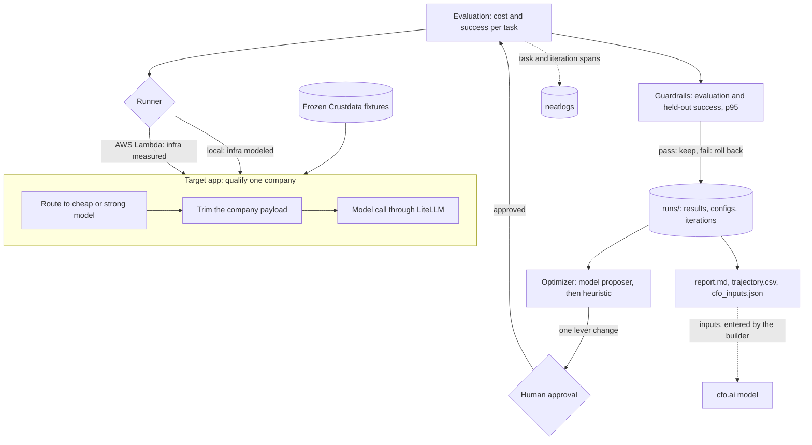

# costwise

costwise is an optimizer agent that lowers the cost of an AI qualification app and shows, on a held-out set, that quality did not drop.

The target app takes a company domain, reads Crustdata company data, and asks a model whether the company fits an ideal customer profile (ICP). costwise runs a fixed workload through the app, proposes one setting change at a time, asks a human to approve it, re-runs the workload, and keeps the change only if the guardrails pass. The build contract is [docs/SPEC.md](docs/SPEC.md); the code layout is in [docs/architecture.md](docs/architecture.md).

## The metric

**Cost per successful task**: model, infra, and data cost summed over every task in a run, divided by the number of tasks whose fit answer matched the expected label.

- Model cost is measured: the token counts the model endpoint reports, times the per-token prices in `config/pricing.yaml`.
- Infra cost is measured from Lambda `REPORT` lines with the Lambda runner, and modeled from local wall time with the local runner.
- Data cost is modeled: Crustdata credits recorded when each fixture was fetched, times the configured price per credit.

Every cost line in the report says which of these it is.

A change is kept only when all three guardrails pass against the current accepted config (limits in `config/policy.yaml`):

- success on the evaluation split drops by at most 2 percentage points;
- success on the held-out split drops by at most 2 percentage points;
- p95 latency on the evaluation split grows by at most 25%.

Passing the guardrails is not enough: cost per successful task must also drop by at least `min_saving_pct` (1%) against the current accepted config, otherwise the change is rolled back. Proposals rejected in earlier runs that started from the same config are remembered and not tried again.

The optimizer and the approver only ever see the evaluation split.

## Architecture



The levers are model routing, the company fields sent to the model, the output token cap, caching repeated company lookups, and Lambda memory (Lambda runner only).

## Quickstart

```
make install                 # uv sync --all-extras --all-groups
make check                   # format, lint, types, layers, tests, coverage
cp .env.example .env         # fill in keys locally; .env is gitignored
```

`.env` needs `LITELLM_BASE_URL`, `LITELLM_API_KEY`, and `MODEL_BUDGET_USD` for any run. `NEATLOGS_API_KEY` turns on trace export. `CRUSTDATA_API_KEY` is only needed to fetch fixtures. The models are `claude-haiku` (cheap) and `claude-sonnet-4.6` (strong) on the neatHack LiteLLM proxy. `config/pricing.yaml` uses the per-token rates the proxy reports for them.

The raw company fixtures are not in the repository because they name real people. A fresh clone has `fixtures/domains.txt` and `fixtures/labels.json`, and must fetch the raw files once:

```
uv run costwise fixtures build      # fetch each listed domain from Crustdata (2 credits each)
uv run costwise fixtures label      # re-label with the ICP rule and choose the held-out split
```

## Demo command sequence

```
uv run python scripts/smoke_neatlogs.py            # one fake task and iteration trace to neatlogs
uv run python scripts/dry_run.py                   # 5 tasks; refuses if the full plan exceeds half the budget
uv run costwise eval baseline --run-id demo        # version 1 on the full workload
uv run costwise optimize --run-id demo --iterations 3   # asks y/n for each proposal
uv run costwise report --run-id demo               # writes runs/demo/report/
```

## Commands

`optimize` reuses the stored version-1 baseline for the run id, or runs it first. Each iteration proposes one lever change, asks for approval (`--auto-approve` skips the question), re-runs the full workload, and keeps the change only if every guardrail passes and cost per successful task drops against the current accepted config. It stops at the iteration limit, when nothing is left to propose, after two rejections in a row, or at the budget stop line.

`report` reads the stored results and iterations and writes four files to `runs/<run_id>/report/`:

- `report.md`: baseline versus final accepted cost per successful task, the model, infra, and data split with a `[source: ...]` tag on every cost line, evaluation and held-out success rates on separate rows, p95 latency, the iteration table, and a section on what is measured and what is modeled.
- `trajectory.csv`: one row per evaluated version, including rolled-back ones.
- `cfo_inputs.json`: baseline and optimized unit costs, the cost split, task counts, and sources for the cfo.ai model. `price_per_task_usd` and `monthly_volume_scenarios` are left empty for you to fill in as assumptions.
- `trajectory.mmd`: a Mermaid `xychart-beta` of cost per successful task by version.

## AWS Lambda runner (optional)

With the Lambda runner, each task is one invocation of a deployed function, and infrastructure cost is measured from the `REPORT` log line (billed duration and memory) instead of modeled. It also enables the Lambda memory lever.

```
make lambda-build      # build build/costwise-lambda.zip; no AWS calls
make lambda-deploy     # create or update the role and function (needs AWS credentials)
uv run costwise eval baseline --run-id lambda-smoke --runner lambda --tasks 3
make lambda-teardown   # delete the function and role after the demo
```

Defaults are region `us-east-1` and function `costwise-qualify`; set `AWS_REGION` and `LAMBDA_FUNCTION_NAME` to change them. The deploy creates only an IAM role with the basic execution policy and one function, both tagged `project=costwise`. It copies `LITELLM_BASE_URL` and `LITELLM_API_KEY` from `.env` into the function's environment and bundles the company fixtures, so no Crustdata or neatlogs key goes to AWS. The model budget is enforced on the machine running the CLI, which charges every model call the function reports.

## Telemetry

- With `NEATLOGS_API_KEY` set, task and iteration spans are exported to neatlogs over OTLP/gRPC with TLS at `ingest.neatlogs.com:443`, using the `x-api-key` header.
- Without it, telemetry is discarded.
- Check the neatlogs connection with `uv run python scripts/smoke_neatlogs.py`, then find the logged `run_id` in the dashboard.
- Summary metrics go only to a local Collector. Start it with `docker compose --env-file .env -f infra/collector/docker-compose.yaml up -d` and set `OTEL_COLLECTOR_ENDPOINT=localhost:4317`. The Collector writes `infra/collector/data/telemetry.jsonl`.
- If exports hang with `DEADLINE_EXCEEDED`, set `GRPC_DNS_RESOLVER=native` in the environment.

## Limitations

- **Data cost is modeled.** It is fixture credits times a configured price per credit. The hackathon Crustdata credits are free, so the price per credit is an assumption you must state.
- **Companies come from frozen fixtures.** The app does not call Crustdata at run time, so data latency and live data changes are not part of the measurement. The cache lever counts repeated companies in the workload as cache hits rather than timing a real cache.
- **Labels are rule-based.** Success means the model's answer matches the ICP rule in `config/icp.yaml`, not a human judgment. 8 of 39 fixture companies fit, so always answering "not a fit" would score about 79%.
- **The infra lever is small.** Lambda memory only matters with the Lambda runner, and infra is a small share of cost next to model and data cost. Locally, infra cost is modeled from wall time and the memory lever is not offered.
- **Small workload.** 28 requests (23 evaluation, 5 held-out), sized so a baseline and one iteration fit the $20 shared model allowance. Differences of a few percentage points are within noise, and one held-out miss is a 20-point drop.
- **Prices are configuration, not a bill.** Model prices are the LiteLLM proxy's own rates, read on 2026-10-12. The Lambda prices are the build spec's values and have not been checked against the AWS pricing page or a bill. The Crustdata price per credit is still `0.00`, so data cost shows as zero until an assumption is set.
- **Not yet run live.** As of v0.1.0, no run has used a real model key, AWS, or neatlogs. Open items are tracked in [docs/open-verifications.md](docs/open-verifications.md).
