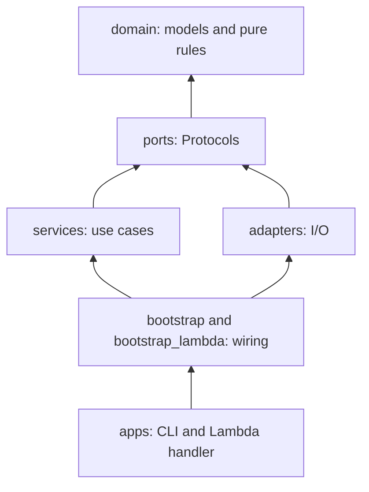

# Architecture

costwise uses ports and adapters. Business rules sit in the middle, I/O sits at the edge, and one composition root chooses the concrete pieces.

## Layers

Arrows point at what a layer may import. `lint-imports` (run by `make check`) enforces this with the contracts in `pyproject.toml`:

- `domain` imports nothing else in costwise.
- `ports` import only `domain`.
- `services` never import `adapters`, `bootstrap`, or `apps`.
- `adapters` never import `services`, `bootstrap`, or `apps`.
- `domain` and `services` never import an I/O library such as `httpx`, `boto3`, `botocore`, `opentelemetry`, `yaml`, or `typer`.

| Layer | Folder | What lives there |
| --- | --- | --- |
| domain | `src/costwise/domain` | Frozen pydantic models and pure functions: config and levers, cost math, run summaries, guardrails, proposal validation, ICP rule. |
| ports | `src/costwise/ports` | `Protocol` interfaces for everything with side effects. |
| services | `src/costwise/services` | The task pipeline, evaluation, baseline, budget, optimizer and proposers, the approval loop, and the report. They receive ports through their constructors. |
| adapters | `src/costwise/adapters` | HTTP clients, runners, file stores, telemetry sinks, approvers, YAML loaders, the system clock. |
| bootstrap | `src/costwise/bootstrap.py`, `bootstrap_lambda.py` | The only modules that pick concrete adapters. `bootstrap.py` reads settings for the CLI; `bootstrap_lambda.py` builds the task inside Lambda. |
| apps | `src/costwise/apps` | Thin entry points: parse input, call one service, print or return the result. |

## Ports

| Port | Module | Used by | Adapters (tests use fakes from `tests/testing_fakes`) |
| --- | --- | --- | --- |
| `LLMClient` | `ports/llm.py` | task pipeline, `LLMProposer` | `OpenAICompatibleClient`, wrapped by the retry and budget decorators |
| `CompanyDataSource` | `ports/data.py` | task pipeline, fixture build | `CrustdataClient` (live), `FixtureCompanySource` (frozen fixtures) |
| `FixtureStore` | `ports/fixtures.py` | fixture service | `JsonFixtureStore` |
| `QualificationTask` | `ports/runner.py` | runners, Lambda handler | `TaskService` |
| `TaskRunner` | `ports/runner.py` | evaluation, approval loop | `LocalRunner`, `LambdaRunner` |
| `BudgetGuard` | `ports/budget.py` | LLM decorators, `LambdaRunner` | `BudgetService` |
| `RunStore`, `ConfigStore` | `ports/storage.py` | evaluation, baseline, approval loop, report | `JsonlRunStore`, `FileConfigStore` |
| `ReportSink` | `ports/report.py` | report | `FileReportSink` |
| `Approver` | `ports/approval.py` | approval loop | `CliApprover`, `AutoApprover` |
| `TelemetrySink` | `ports/telemetry.py` | evaluation, baseline, approval loop | `OtelSink` (neatlogs, optional Collector), `NullSink` |
| `Clock` | `ports/clock.py` | runners, task pipeline, telemetry | `SystemClock` |

`Proposer` (`services/optimizer.py`) is a service-level Protocol with two implementations: `LLMProposer` asks the strong model, and `HeuristicProposer` applies fixed rules. `OptimizerService` tries them in that order, re-validates each proposal, and drops one that is out of bounds, makes no change, or repeats a rejected change.

## Flow of one iteration

1. `IterationService` asks `OptimizerService` for one proposal, using the evaluation-split summary of the current accepted config. Rejected proposals from this run, plus those from earlier runs with the same starting config (`earlier_rejections` in `services/history.py`), count as rejected.
2. The `Approver` sees the proposal and the evaluation evidence, then approves or declines it.
3. An approved proposal becomes a new config version through `apply_proposal`. If the lever needs infrastructure, the runner applies it and runs three warm-up invocations that are not recorded.
4. `EvaluationService` re-runs the whole workload. `judge` in `services/verdict.py` compares both splits against the current accepted config with `evaluate_guardrails`.
5. The change is kept only if every guardrail passes and cost per successful task drops by at least `min_saving_pct`; otherwise the infrastructure is rolled back. The record goes to the `RunStore` and the `TelemetrySink`.

## How to add a lever

1. `domain/config.py`: add a member to `Lever` and a field to `OptimizerConfig`, with bounds.
2. `domain/proposals.py`: add a branch to `_parsed_value`, `_same_as_current`, and `_with_lever` so that proposals for the lever are parsed, compared, and applied.
3. Read the new field where it takes effect, usually in `services/task.py` or one of its steps (`routing.py`, `payload.py`, `prompt.py`), or in a runner's `apply_infra` if it changes infrastructure.
4. Offer it from runners that support it: `capabilities()` in `adapters/runners/local_runner.py` and `lambda_runner.py`. If it needs warm-ups after a change, extend the check in `IterationService`.
5. Teach the proposers: add a rule to the `HeuristicProposer` rule list in `services/proposers.py`, and describe the value format in the prompt in `services/llm_proposer.py`.
6. Add the initial value to `config/policy.yaml`.
7. Add tests in `tests/unit/domain/test_proposals.py`, `tests/unit/services/test_proposers.py`, and the step that uses the lever.

## How to add a runner

1. Write an adapter in `src/costwise/adapters/runners/` that satisfies `TaskRunner`:
   - `capabilities()` returns the levers it supports and whether infra cost is measured or modeled;
   - `apply_infra(config)` changes infrastructure, or does nothing;
   - `run(request, config)` returns an `InvocationResult` with `billed_ms` and `memory_mb` filled in.
2. Charge the `BudgetGuard` for any model call made outside this process, as `LambdaRunner` does.
3. Turn transport failures into `RunnerError`. Evaluation records them as errored tasks instead of stopping the run.
4. Add a `RunnerKind` member and a branch in `build_eval_stack` in `bootstrap.py`.
5. Add contract tests against recorded or stubbed responses; tests never touch the network.
