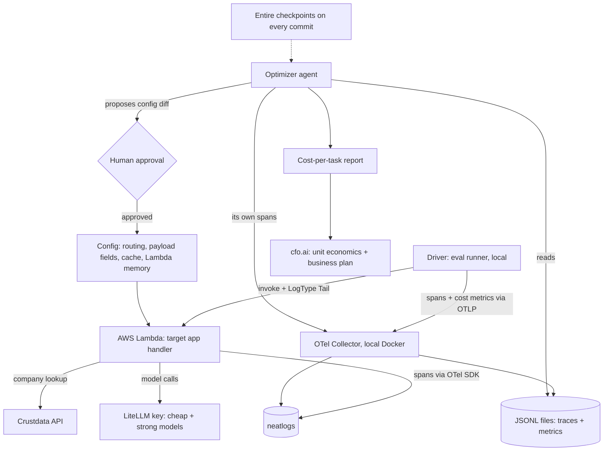

# Stack and Integration Plan: AI-Infra Cost Agent

How each tool is used, exactly. Companion to `ai-infra-cost-agent.md`.

**Interpretation of "Crustdata as a customer":** the target app is a Crustdata-powered B2B account-qualification service. Crustdata supplies the data the app works on, and the pitch customer is any team running a Crustdata-style enrichment agent. This implies no partnership or endorsement; do not claim one in the submission.

**Items marked VERIFY are things I could not confirm.** Check them before building around them (section 9).

---

## 1. System overview



---

## 2. The target app: account qualification

**Task:** given a company domain, decide whether it fits a fixed ideal-customer profile (ICP) and return structured JSON.

```json
{ "domain": "example.com", "icp_fit": true, "reasons": ["..."], "headcount_band": "51-200", "stage": "Series A" }
```

**Why this task:**
- Ground truth comes from a **deterministic rule** applied to the Crustdata data (for example: headcount above a threshold AND funding stage in a set AND hiring signal present). The label is computed by code, so scoring needs no LLM judge and costs nothing.
- The model must reason over a long, noisy API payload, so **payload size is a real cost lever**.
- Difficulty is naturally mixed: clear-cut companies (easy) and ones with missing or conflicting fields (hard). That gives a router something to learn.

**Fixtures (important for repeatability):**
1. Pick about 50 company domains spanning the easy/hard range.
2. Fetch each once from Crustdata and **save the raw responses** to `fixtures/`.
3. Compute the rule-based label for each. Hold out 10 as a test set the optimizer never sees.
4. Eval runs read fixtures, so repeated runs do not burn Crustdata credits.
5. Separately, measure real Crustdata credits per call once, and apply that figure when computing data cost. Label it as measured-once, not per-run.

---

## 3. Per-tool usage

### 3.1 Crustdata (data source)

- **Credits:** 5,000 for participants, claimed with promo code `NEATLOGS-OCT2026` at app.crustdata.com via email signup (not Google).
- **Endpoints to use:** the indexed Company APIs (search by name or domain, enrich a known company). Company search is `POST https://api.crustdata.com/company/search` with header `x-api-version: 2025-11-01`.
- **Avoid live endpoints:** the docs say Company and Person live endpoints are enterprise-only and plan-specific. Stay on indexed data. VERIFY which endpoints your credits cover.
- **Role in the cost model:** a third cost component, **data cost per task** (credits × effective price per credit).
- **New lever it creates:** caching Crustdata responses. Repeat lookups cost zero credits. The optimizer can propose "cache company payloads by domain", and the saving is measurable.
- **Do not** put the API key in the repo. Use environment variables.

### 3.2 LiteLLM (models)

- One shared **$20** budget for the whole team. Seven models (Nova and Claude) behind one OpenAI-compatible API.
- Pick two tiers: a cheap model and a strong model. Record their per-token prices from the LiteLLM or provider pricing, VERIFY exact model names and prices.
- Add a hard budget guard in code: stop the run at 80% of what you have left.

### 3.3 AWS (infrastructure lever)

- **Allowance:** $25, us-east-1, EC2/Lambda/IAM/load balancers. Bedrock is **not** included (models come via LiteLLM only).
- **What runs on AWS:** one **Lambda function** containing the target app handler (fetch fixture or Crustdata payload, trim, call LiteLLM, score, return JSON).
- **Lever:** Lambda memory size (for example 256, 512, 1024, 2048 MB). CPU scales with memory, so duration and cost trade off.
- **Measuring real infra cost with no extra tooling:** invoke with `LogType='Tail'` in boto3. The response includes the last log lines, which contain the REPORT line with `Duration`, `Billed Duration` and `Memory Size`. Parse it.
- **Cost formula:** `infra_cost = billed_seconds × (memory_mb / 1024) × price_per_GB_second + request_fee`. Look up the current price on the AWS Lambda pricing page. VERIFY.
- **Budget reality:** a few hundred short invocations cost cents. The $25 is not the constraint; avoid leaving anything else running (no EC2, no load balancers).
- **Packaging:** zip deployment with dependencies. If packaging eats more than about 90 minutes, fall back to Docker with `--cpus` and `--memory` limits and a clearly labeled pricing model. Never present modeled numbers as measured.
- **Teardown:** delete the function and any IAM roles after the demo recording.

### 3.4 OpenTelemetry (foundation)

**Two sources of spans:**

| Source | Where it runs | Exports to |
|---|---|---|
| Target app spans | Inside Lambda | neatlogs directly (see 3.5); force flush before the handler returns |
| Driver and optimizer spans, cost metrics | Local | Local OTel Collector, which fans out to neatlogs and local JSONL |

**Why not send Lambda spans to the local Collector:** Lambda cannot reach `localhost`. Instead, the Lambda returns its usage and result in the response, and the **driver** emits the cost span attributes and metrics from its side.

**Span attribute schema (use these names consistently):**

| Attribute | On | Meaning |
|---|---|---|
| `task.id` | task root span | Unique task id (traces only, never metrics) |
| `task.category` | task root span | easy / hard |
| `task.success` | task root span | bool, from the scorer |
| `gen_ai.request.model` | model span | model used |
| `gen_ai.usage.input_tokens` / `output_tokens` | model span | token counts |
| `cost.model_usd` | task root span | model spend for the task |
| `cost.infra_usd` | task root span | Lambda spend from REPORT line |
| `cost.data_usd` | task root span | Crustdata credit cost (0 on cache hit) |
| `config.version` | task root span | which optimizer config produced this run |

**Metrics (low cardinality only):** `cost_per_task_usd`, `success_rate`, `latency_p95_ms`, all labeled by `config.version` and `task.category`. Do not label by task id.

**Collector sketch** (VERIFY the neatlogs exporter settings before using):

```yaml
receivers:
  otlp:
    protocols:
      http:
exporters:
  otlphttp/neatlogs:
    endpoint: https://<neatlogs-otlp-endpoint>   # VERIFY
    headers:
      x-api-key: ${NEATLOGS_API_KEY}              # VERIFY header name
  file:
    path: /data/telemetry.jsonl
service:
  pipelines:
    traces:
      receivers: [otlp]
      exporters: [otlphttp/neatlogs, file]
    metrics:
      receivers: [otlp]
      exporters: [file]
```

The optimizer reads `telemetry.jsonl`. Keep the local store this simple; do not stand up a full observability backend.

### 3.5 neatlogs (required)

- neatlogs is OpenTelemetry-based. Its Go SDK documents OTLP/HTTP export to `{endpoint}/v1/traces` with an `x-api-key` header. The Python SDK documents a different batch endpoint, so **VERIFY** what works from Lambda and from a Collector.
- **Safe default:** use the neatlogs Python SDK inside the Lambda and the driver (`neatlogs.init(...)`, `flush()`), and use the Collector only for the local JSONL copy.
- **What you show judges:**
  1. A baseline trace and an optimized trace for the same task, side by side.
  2. A run comparison between config versions.
  3. At least one failure found in traces and then fixed (for example, an easy task misrouted to the strong model, or a payload that was too large).
  4. The optimizer's own traces (analyze, propose, approve, verify, rollback).
- Check in the dashboard that your custom `cost.*` attributes appear. The SDK normalizes attributes into its own namespace, so they may need a different path.

### 3.6 Entire (required)

- Run `entire enable` in the repo on day one.
- Commit after each meaningful step: app skeleton, fixtures, scorer, baseline run, each optimizer capability, each accepted config change.
- Each accepted config change is its own commit, so its checkpoint ties the code and the agent session to that change.
- Put the **checkpoint link and ID** in the submission, as the email requires.

### 3.7 cfo.ai (required)

- Sign up through `cfo.ai/neathacks`, then **cancel the subscription immediately** in Settings, Billing (a card is required at signup).
- **Inputs:**

| Input | Source |
|---|---|
| Cost per successful task, baseline and optimized | Your results |
| Cost split: model / infra / data | Your results |
| Price you charge per qualified account | **Your assumption**, label it as such |
| Monthly volume scenarios (low / base / high) | Your assumption |
| Fixed costs (hosting, tools) | Your estimate |

- **Outputs to include:** gross margin before and after optimization, break-even volume, runway under each scenario.
- **The story:** the optimizer's savings are the reason the margin moves. Show both models side by side.

---

## 4. Cost model

```
cost_per_successful_task =
  (model_cost + infra_cost + data_cost) / successful_tasks
```

- `model_cost`: tokens × per-model price
- `infra_cost`: Lambda billed GB-seconds × price + request fee
- `data_cost`: Crustdata credits × effective price per credit (zero on a cache hit)
- Divide by **successful** tasks so the agent cannot win by being cheap and wrong.

---

## 5. Optimizer agent

**Reads:** `telemetry.jsonl` (traces and metrics), the current config, the guardrails.

**Config it can change (one change per iteration):**

```json
{
  "routing": { "rule": "missing_fields>=2 -> strong, else cheap", "cheap": "<model-a>", "strong": "<model-b>" },
  "payload_fields": ["employee_count", "funding_stage", "hiring"],
  "max_output_tokens": 300,
  "cache_crustdata": true,
  "lambda_memory_mb": 1024
}
```

**Guardrails (hard gates):**
- Success rate on the eval set at least baseline minus 2 points
- p95 latency within the SLO
- Held-out set checked separately
- Human approval before any change is applied

**Per iteration:** analyze cost by `task.category` and by component, propose a diff with a predicted effect, get approval, apply, re-run, verify, keep or roll back, log the reason.

---

## 6. Setup checklist

Environment variables (never commit them):

```
NEATLOGS_API_KEY=
LITELLM_API_KEY=
LITELLM_BASE_URL=
CRUSTDATA_API_KEY=
AWS_ACCESS_KEY_ID=
AWS_SECRET_ACCESS_KEY=
AWS_REGION=us-east-1
```

Order:
1. Accounts: neatlogs, Entire (`entire enable`), cfo.ai (cancel subscription), Crustdata promo code, LiteLLM key from the check-in email
2. Fetch and freeze fixtures; compute labels; split off the held-out set
3. Handler running locally; scorer working; neatlogs traces visible
4. Deploy Lambda; test invoke with `LogType='Tail'`; parse the REPORT line
5. Driver plus Collector; confirm `cost.*` attributes land in neatlogs and in the JSONL
6. Baseline run; first public build post
7. Optimizer loop; three iterations
8. cfo.ai model, README evidence, demo video, submit

---

## 7. Budget checks

- Model: 5-task dry run first, read real cost per task from neatlogs, then size runs to leave 2x headroom of the shared $20
- Runs: baseline plus three iterations, plus a held-out pass
- Crustdata: fixtures cost credits once; live calls only for the one-time credit measurement
- AWS: Lambda only; delete everything at the end

---

## 8. Evidence checklist for the submission

- [ ] neatlogs: baseline vs optimized trace, run comparison, one failure found and fixed, optimizer traces
- [ ] OpenTelemetry: schema table, Collector config, metrics screenshot
- [ ] Entire: checkpoint link and ID, dense commit history
- [ ] cfo.ai: business plan with before and after margin
- [ ] AWS: Lambda REPORT-line cost data for at least two memory sizes
- [ ] Crustdata: fixtures, measured credit cost, cache-hit saving
- [ ] Held-out results reported separately
- [ ] Build-in-public posts (baseline, a failure, the final number)
- [ ] Demo video (about 2 minutes)

---

## 9. Verify first (unknowns)

1. Does neatlogs accept OTLP directly from a Python app or Collector, and at what endpoint and header? (Go SDK documents `/v1/traces` with `x-api-key`; Python docs show a batch endpoint.)
2. Do your `cost.*` attributes survive neatlogs' attribute normalization?
3. How many Crustdata credits does each call cost, and are the indexed Company endpoints covered by your promo credits?
4. Exact LiteLLM model names and per-token prices.
5. Current Lambda price per GB-second.
6. Hackathon rules on pre-existing code and on the public repo and demo format.

Ask 1, 2 and 6 in the neatHack Discord today.

---

## 10. Risks

- **Setup load:** Lambda, Collector, Crustdata, LiteLLM and three required tools in one day. Cut order if behind: Lambda becomes Docker with a labeled pricing model, approval UI becomes a CLI prompt, three iterations become two.
- **Infra lever is small:** most latency is the model call, so memory tuning moves cost modestly. Say so.
- **Fixture realism:** frozen data makes runs repeatable but is not live. Be upfront about it.
- **Originality:** cost-aware routing exists elsewhere. Your differentiators are the unified three-part cost metric, the data-cache lever, and the verified loop.
- **Rule-based labels:** the ICP rule is arbitrary. Do not claim the agent finds "good customers"; claim it matches a stated rule at lower cost.
